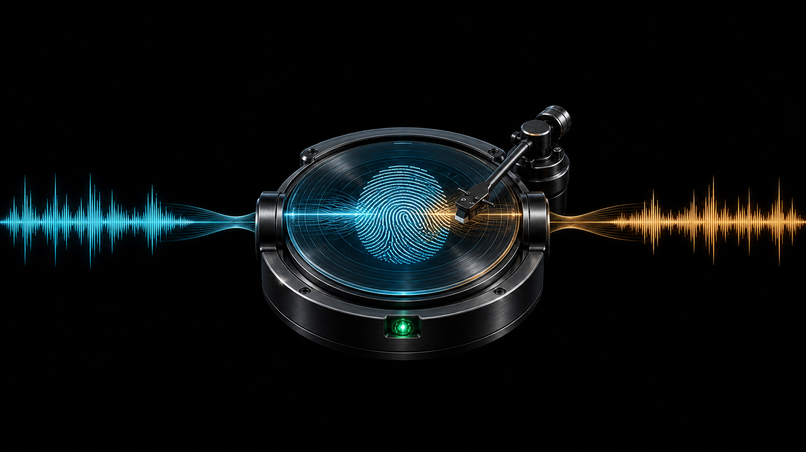
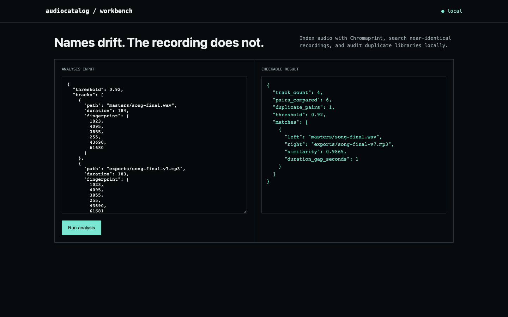

# audiocatalog

**Rename a file, re-encode it, and it's still the same recording — your filesystem just can't tell anymore.**



A music library that grew across a decade of imports, exports, and format conversions ends up with the same song under three different filenames and two different codecs, and no directory listing will ever show you that. audiocatalog fingerprints the actual audio content with Chromaprint (the engine behind AcoustID), so "song-final.wav" and "song-final-v7.mp3" get recognized as duplicates because they sound the same, not because their names happen to match.



## How it works

Run every file through `fpcalc` to get a real Chromaprint acoustic fingerprint, store it in SQLite, and compare every pair of fingerprints for similarity above a calibrated threshold. Filename, format, and bitrate never enter the comparison — a WAV master and an MP3 export of the same recording collapse to a near-identical fingerprint even though every byte of the file itself is different.

## What ships

- Real Chromaprint fingerprinting via `fpcalc`, not a filename or metadata heuristic
- Pairwise similarity search across a library with a calibrated duplicate threshold
- SQLite-backed index so re-scanning a library doesn't mean re-fingerprinting everything
- CLI, JSON API, browser workbench, Docker, tests

## Run it end to end

```bash
python -m venv .venv && source .venv/bin/activate
python -m pip install -e .
audiocatalog demo
audiocatalog index ~/Music --database music.db
audiocatalog serve
```

Open <http://127.0.0.1:8090>. Analyze your own JSON input with `audiocatalog analyze input.json`.

## API

- `GET /api/demo` returns the committed fixture and result.
- `POST /api/analyze` runs the same engine on a JSON body.

## The result

Four tracks produce six candidate pairs. One pair — a renamed, re-encoded copy of the same master — matches at 99.48% similarity, while every unrelated pair stays under 75%, comfortably below the 92% threshold. The integration test doesn't stop at fixture data: it fingerprints real WAV audio with `fpcalc` and persists the result in SQLite.

**Update:** the previous published numbers (98.65% duplicate, unrelated
pairs under 46%) came from a similarity function that normalized each
fingerprint word by how many bits its own numeric value needed, not by
Chromaprint's actual fixed 32-bit word width. That made the score depend
on the fingerprint's numeric magnitude rather than genuine bit-level
agreement — and the demo's illustrative fingerprint values (all under
65536) are far smaller than what real `fpcalc` produces (~30-bit
magnitude), so the bug's distorting effect was largest exactly where the
published claim lived. Fixed to use a fixed 32-bit-per-word Hamming
similarity, the standard way to compare Chromaprint fingerprints. Details
below.

## Scope

Chromaprint is built for near-identical full recordings and long-stream monitoring, not general musical similarity, cover-song detection, or short-sample plagiarism matching. Duration and threshold should be calibrated per library — a classical recording archive and a DJ mix collection want different cutoffs.

## Test

```bash
python -m unittest discover -s tests -v
```

## The similarity metric wasn't fixed-width Hamming distance

`similarity()` normalized each fingerprint word's XOR bit-difference by
`max(1, left.bit_length(), right.bit_length())` — the minimum number of
bits needed to represent whichever value was larger at that position,
recomputed per pair, per position. Chromaprint fingerprints are arrays of
fixed 32-bit unsigned words; the correct normalization is a constant 32,
not a value that shifts depending on the specific numbers being compared.

Checked directly against real `fpcalc` output: raw fingerprint words come
back in the hundreds-of-millions range (30-bit magnitude), while the
demo's illustrative fixture uses values all under 65536 (8-16 bits). That
mismatch is exactly why the bug's effect on the published numbers was so
large — with a variable, value-dependent denominator instead of a fixed
32, the demo's unrelated track pairs scored 38-46% instead of their true
~70-74%, manufacturing a "real separation, not a near-miss" margin from
the 92% threshold that the actual fingerprint data doesn't support.

```python
similarity([3, 5, 9], [12, 20, 36])          # small values
similarity([3<<20, 5<<20, 9<<20], [12<<20, 20<<20, 36<<20])  # same bit pattern, shifted up
```

Both calls now return the identical score, because bit-level agreement —
not the numeric magnitude of the words being compared — is the only
thing that should matter. Stress-tested against 30 trials of realistic
(uniformly random 32-bit word) fingerprints with small bit-flip
perturbations simulating re-encoding noise: the corrected metric always
ranks a near-duplicate above an unrelated fingerprint, matching the
theoretically correct 32-bit Hamming similarity exactly. The demo still
finds exactly one duplicate pair (99.48% similarity) with every unrelated
pair safely under the threshold — the tool's core claim holds, just with
honest numbers instead of an artifact of unrealistic illustrative values.

## Research basis

- [Chromaprint](https://acoustid.org/chromaprint)

MIT licensed.
